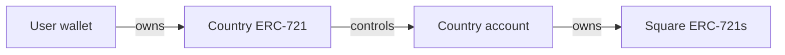

# Square ownership: findings and recommendation

Architecture review, 5 October 2026. This records a recommendation, not an adopted design or an implementation specification.

**Recommendation: keep squares as permanent ERC-721 tokens, keep countries as ERC-721 tokens, and give each country a minimal, immutable ERC-6551 account that owns its squares.** Shared custody is a credible simpler alternative. The registry-only approach in the current uncommitted changes conflicts with the requirement that acquired land squares remain NFTs.

## Project goals and review scope

The intended model, inferred from the repository, ownership-options canvas, and discussion, is:

- Each acquired square is an individually identifiable land asset.
- Countries group squares and can be traded as a unit.
- Countries can grow and eventually support splitting and merging land.
- Geographic constraints, collision prevention, and auction reservations apply on-chain.
- Core contracts are intended to be immutable.

The review covered the uncommitted country and auction changes, their interfaces and tests, the previous square and country contracts, and the local `square-ownership-options.canvas.tsx` file. Relevant token standards and Base fee documentation were also checked. No competing implementations were built or benchmarked, and this was not a security audit.

## What the current attempt changes

Previously, `GaiaLocation721` represented square NFTs and `Country1155` held them with a country-to-squares record. The uncommitted implementation replaces these with [`GaiaCountries`](../../contracts/GaiaCountries.sol): ERC-721 countries plus a square-to-country mapping. Square ownership resolves through the country token owner.

Consequently, squares held in countries are no longer ERC-721 tokens. The canvas proposes minting standalone square NFTs on splitting and burning them on merging, but those operations are not implemented in the reviewed code.

Useful changes to retain include ERC-721 countries, deterministic coordinate-derived square IDs, issuer separation, and the auction holding a country until its final settlement chunk completes.

## Options

| Model | Acquired squares remain NFTs | Square ownership while bundled | Assessment |
| --- | --- | --- | --- |
| Registry; tokenise when split | No | A country mapping, with no square token | Efficient, but does not meet the desired asset model. |
| Shared custody, ERC-998 style | Yes | One custody contract, plus country membership | Credible simpler alternative. |
| ERC-6551 account per country | Yes | The country's canonical account address | Recommended fit for countries owning land. |
| Custom vault per country | Yes | A dedicated vault address | Useful narrower alternative to a general account. |
| ERC-6059 nested NFTs | Yes | Explicit parent-token relationship | Worth considering if richer nesting becomes a product feature. |
| Wallet-owned squares with country labels | Yes | The user's wallet | Does not preserve country ownership automatically without transfer restrictions or different product semantics. |

### Recommended: ERC-721 squares and country accounts

Mint each square when first acquired, with a permanent ID derived from `lat * 36000 + lng`. There is no need to mint the entire world in advance. Splitting and merging transfer the existing token rather than burning and recreating it.

A country sale transfers the country NFT. Its square NFTs remain at the same account address, so selling a country does not require a transfer loop over all its squares. Gaia can derive membership by looking up the square's owner address in a canonical account-to-country registry. A standalone square still exists even though it belongs to no country: `countryOf(square) == 0` must never become the test for whether land is unminted.

ERC-6551 defines deterministic accounts associated with NFTs and lets Gaia choose the account implementation. Its canonical registry is immutable and ownerless. Accounts can receive assets before deployment, although lazy deployment should be treated as an optimization with explicit recognition and deployment checks. See the [ERC-6551 specification](https://eips.ethereum.org/EIPS/eip-6551).

Use a small, immutable Gaia account implementation whose execution authority follows the current country owner. Avoid upgrade mechanisms, plugins, persistent delegated permissions, and arbitrary `delegatecall`. Supporting ERC-6551 does not require adopting a large third-party wallet framework.

Gaia should display both immediate ownership and country control. Bundled squares belong to the account, so they will not necessarily appear as directly owned assets in the user's wallet. Individually selling one requires a valid split. Standards compliance alone does not guarantee that external wallets or marketplaces present the hierarchy well.

### Shared custody

One contract can hold all square NFTs and record their country membership. This meets the requirement that squares remain ERC-721s and keeps country operations within a compact set of contracts.

The tradeoff is that `ownerOf(square)` reports the shared custody contract. Integrations need an additional lookup to identify the country and its controller. This is a reasonable choice if minimizing implementation scope matters more than giving countries their own addresses.

“ERC-998 style” is a description of the pattern, not a compliance claim. The actual standard defines additional interfaces. Gaia need not adopt all of that machinery merely to implement custody. See [ERC-998](https://eips.ethereum.org/EIPS/eip-998).

### Custom per-country vaults

A small vault per country can hold square NFTs and authorize Gaia-specific withdrawal operations based on the current country owner. This preserves the dedicated-address model while exposing less functionality than a general account.

It introduces a proprietary interface and still requires secure deployment, authorization, and transfer rules. Prefer this if countries are explicitly intended to remain land containers with no broader account functionality. Otherwise, ERC-6551 provides a standard account association for a similar ownership model.

### ERC-6059 nesting

ERC-6059 models parent and child NFTs directly. It exposes the root owner through `ownerOf`, the immediate parent through `directOwnerOf`, and child proposal, acceptance, and transfer operations. See [ERC-6059](https://eips.ethereum.org/EIPS/eip-6059).

This is relevant if Gaia eventually needs countries containing districts containing properties. For the current one-level grouping of squares into countries, its lifecycle and nesting machinery appear unnecessary. Integration behavior would need to be tested rather than assumed from ERC-721 compatibility.

## Qualifications to the canvas

**The gas ranking is provisional.** Alternative settlement costs were extrapolated from prototype measurements. Shared custody does not inherently require two storage slots per square: a custom storage layout could pack an owner address and a bounded country ID into one word. That would require departing from a straightforward stock ERC-721 storage implementation and carries additional implementation risk. The claimed 1.8× cost is not an architectural law.

**Immutability makes every custody implementation consequential.** ERC-6551 adds account code to review, but shared custody also depends on permanent withdrawal and authorization logic. Compare concrete implementations rather than treating one as dependency-free in a security sense.

**Standard transfers still need Gaia rules.** Account-to-wallet and wallet-to-account transfers can represent splits and merges, but source connectivity, destination geometry, and destination-owner consent must hold across every supported transfer path. A receiving hook alone is insufficient because ERC-721 `transferFrom` does not invoke it.

**Dollar estimates are snapshots.** Base transactions incur both execution and L1 publication fees. The 68-byte calldata for a settlement function call is not the entire serialized transaction. A settlement-only whole-map estimate also excludes bidding and later land operations. Benchmark end-to-end transactions under explicit assumptions; see [Base network fees](https://docs.base.org/specifications/transactions/network-fees).

## Decisions required before implementation

### Geographic invariants and batches

Decide whether countries must remain connected, convex, hole-free, or some combination after growth and splitting. Auction shape validity and persistent country validity need not be identical, but their relationship must be explicit.

The current `_requireTouches` in [`GaiaCountries.sol`](../../contracts/GaiaCountries.sol) accepts an added batch if any new square touches the country. A batch containing one adjacent square and another distant square can pass. The auction supplies stronger shape checks, but the country contract does not independently establish connectivity for arbitrary issuer batches.

A 3×3 neighborhood cannot fully determine global connectivity for arbitrary shapes: nearby branches might reconnect far away. A conservative local split rule can be safe but reject otherwise valid splits. Its guarantees and limitations need to be specified and tested.

Batch operations also need deliberate semantics. Validating every square independently in input order can reject a valid final shape. Preserve safe settlement chunking while defining how batch growth and batch removal establish the final invariant.

### Consent to growth

An adjacent square transferred into someone else's account should not automatically enlarge their country if only the owner may grow it. Destination-country consent must be authenticated, including for ordinary transfers and transfers between country accounts. Custody and accepted membership must not silently diverge.

### Sales must commit to country contents

A buyer's offer for a country should not remain valid after the seller removes its valuable land. Increment a country composition version on every membership change and bind Gaia sale orders to the expected version, checked atomically during settlement. A version protects against changes after an offer; the buyer still needs an accurate view of the composition when making it.

Generic country NFT transfers do not enforce a buyer's expected composition. External marketplace sales need compatible validation or an explicit locking mechanism. An equal square count is insufficient because different squares may have different value. ERC-6551 describes related asset-removal fraud in its [security considerations](https://eips.ethereum.org/EIPS/eip-6551#fraud-prevention).

### Authority after a country sale

Square approvals granted by a country account can survive a country sale because the square owner address does not change. For Gaia land, require outbound transfers from a registered country account to be initiated by that account itself, with execution authorized by the current country owner. Reject or render unusable external operator approvals for those bundled squares.

This deliberately limits direct marketplace transfers of bundled squares. Supporting delegated execution or account-signed orders later requires explicit invalidation across ownership changes. Gaia's square restrictions would not automatically protect unrelated assets deposited into the account.

### Ownership cycles

Initially disallow transfers of country NFTs into registered Gaia country accounts. The current ownership-loop guard checks deployed contracts only and explicitly leaves longer cycles undetected. Canonical account recognition should work before deployment, rather than relying only on `code.length` or an arbitrary contract's `token()` response.

This restriction handles the supported Gaia hierarchy, not every possible cycle involving arbitrary external smart accounts. Broader nesting would need a separate design.

## Suggested implementation direction

1. Specify country geometry, batch semantics, destination consent, and sale guarantees.
2. Restore a dedicated square ERC-721 contract with deterministic IDs and permanent token identity.
3. Retain ERC-721 countries and register one canonical ERC-6551 account per country.
4. Enforce land rules across all mint and transfer paths; distinguish minted standalone land from unclaimed land.
5. Preserve the auction holding a country until settlement completes, minting its squares to the country's account.
6. Add explicit split/merge operations, composition-version events, and sale validation.
7. Test country-sale authorization changes, approval persistence, ownership cycles, consent, geometry, and batch boundaries before benchmarking.
8. Compare actual settlement, growth, split, merge, and country-sale costs with shared custody using the same invariants and realistic country sizes.

The architectural preference is for country accounts because they preserve square identity and make country ownership concrete. Gas measurements should validate the implementation choice, rather than determine the asset model before its rules are settled.
